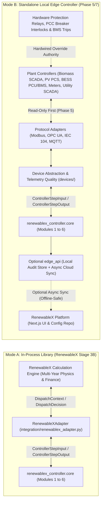
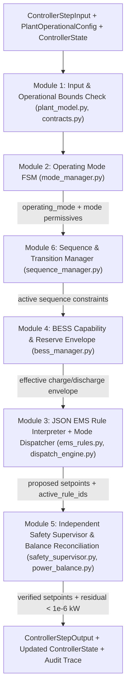
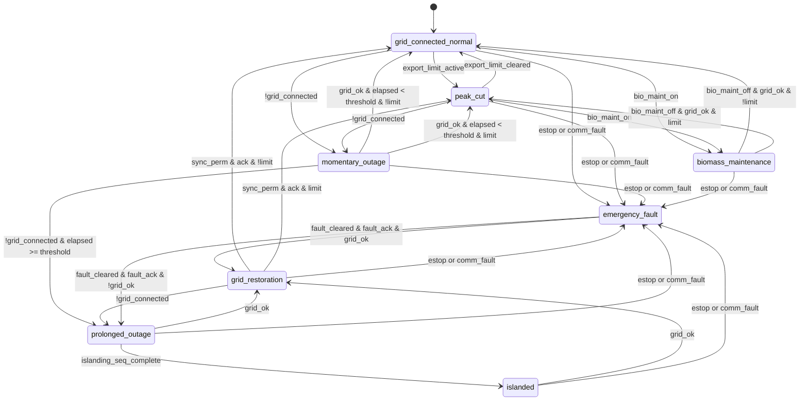

# System Architecture: RenewableX Hybrid Controller

## 1. Control & Software Hierarchy

Supervisory energy management sits strictly at Level 2, isolated from fast hardware protection (Level 0/1), field communication protocols (Level 3), and enterprise planning/UI (Level 4).

| Tier | Responsibility | Time Scale | Location / Ownership |
|---|---|---|---|
| **Level 0/1** | Electrical protection relays (50/51, 27/59, 81O/U, 25 synchrocheck), PCC Breaker interlocks, BMS safety trips, inverter MPPT & V/f loops, biomass governor & AVR | Milliseconds to sub-second | Out of scope. Certified hardware/PLC/PCS/BMS always retains override authority. |
| **Level 2** | Supervisory EMS & Plant Control: Operating Mode FSM, BESS reserve envelope, JSON EMS rule interpreter, residual power dispatch, independent safety supervisor, sequence manager | Seconds to hours (`dt_seconds`) | `renewablex_controller.core` (Phases 0 to 4). Pure Python, deterministic, zero I/O. |
| **Level 3** | Field Edge I/O: Device abstractions, protocol adapters (Modbus, OPC UA, IEC 104, MQTT), telemetry staleness checks, optional local audit store & async cloud sync | Seconds | `devices/`, `adapters/`, `edge_api/` (Phases 5 to 7). Optional extras; never imported by `core/`. |
| **Level 4** | Planning, Physics Simulation & UI: Next.js dashboards, solar geometry, battery degradation, biomass thermodynamics, financial modeling, 8,760-hour engine | Multi-year planning | RenewableX Platform (external repo). Imports `renewablex_controller` in-process. |

### Ports-and-Adapters Dependency Rules

```text
core/         --> Python 3.11+ stdlib + Pydantic v2 ONLY (zero I/O, zero network, zero DB)
integration/  --> core/ (duck-typed Protocol bridge; zero import dependency on RenewableX repo)
simulation/   --> core/ (lightweight stdlib CSV/JSON step harness; zero physics/finance duplication)
devices/      --> core/ (Phase 5+)
adapters/     --> devices/, core/ (Phase 5+; protocol libraries live in optional extras)
edge_api/     --> core/, devices/ (Phase 5/7+; FastAPI/SQLite live in optional extras)
```

## 2. Dual-Mode System Context

The identical `renewablex_controller.core` engine serves both in-process simulation and standalone edge deployment without branching core algorithms:



## 3. Core Component Pipeline (Modules 1 to 6)

Every call to `HybridController.step(state_in)` executes a deterministic six-stage pipeline. Module 5 runs **downstream** of both built-in dispatchers and JSON EMS rules so no rule or mode dispatcher can bypass safety limits.



### Module 5 Atomic Supervision & Reconciliation

Clamping a single unsafe command in isolation would break active-power balance. Module 5 therefore executes two atomic steps:

1. **Clamp or Reject Equipment Commands:** Enforce PV AC limit, biomass min/max/ramp/up-down constraints (scaled by `dt_seconds`), BESS physical and mode-aware reserve bounds, grid import/export ceilings, mutual exclusion, mode permissives, maintenance lockouts, and telemetry health. Record every violation code and mark `constraint_status` as `"clamped"` or `"rejected"`.
2. **Closed-Balance Reconciliation:** Reconcile any residual active-power imbalance through permitted slack paths in deterministic order:
   - **Excess generation:** increase `grid_export_kw` (if grid-connected, export allowed, within limit) -> increase `bess_charge_kw` (within BESS envelope) -> increase `pv_curtailment_kw` (if enabled) -> reduce `biomass_command_kw` (down to `min_load_kw` and ramp floor). If still unbalanced, flag `constraint_status = "infeasible"`.
   - **Generation deficit:** increase `grid_import_kw` (if grid-connected and import allowed) -> increase `bess_discharge_kw` (within BESS envelope) -> record explicit `unmet_load_kw` (`served_load_kw = local_load_kw - unmet_load_kw`). If `parasitic_load_kw` itself cannot be covered, flag `"infeasible"`.
3. **Final Invariant Verification:** Assert `|residual_kw| < 1e-6` and both mutual-exclusion products equal `0.0`.

## 4. Operating Mode Finite State Machine (Module 2)



### Transition Table & Guards

| From State | To State | Guard Condition | Timer / Permissive | Sequence / Action |
|---|---|---|---|---|
| **Any state** | `emergency_fault` | `emergency_stop == True` or stale/unhealthy telemetry when `comm_loss_action == "emergency_fault"` | Immediate (highest priority) | Safe-hold setpoints; abort active sequence; log fault |
| `grid_connected_normal` | `peak_cut` | `grid_connected == True` and `grid_export_limit_kw is not None` | Immediate | Activate peak-cut export ceiling |
| `peak_cut` | `grid_connected_normal` | `grid_connected == True` and `grid_export_limit_kw is None` | Immediate | Resume normal export tracking |
| `grid_connected_normal` / `peak_cut` | `biomass_maintenance` | `biomass_maintenance_mode == True` | Entry sequence if biomass is running | Issue `biomass_stop_request`; dispatch PV+BESS |
| `biomass_maintenance` | `grid_connected_normal` / `peak_cut` | `biomass_maintenance_mode == False` and `grid_connected == True` | Maintenance exit sequence complete | Restore biomass dispatch eligibility |
| `grid_connected_normal` / `peak_cut` | `momentary_outage` | `grid_connected == False` | Starts outage timer (`max(outage_elapsed_seconds, grid_outage_duration_seconds)`) | Hold/protect reserve; await grid return or threshold |
| `momentary_outage` | `previous_grid_mode` | `grid_connected == True` and `effective_outage_s < momentary_outage_threshold_seconds` | Below momentary threshold | Reset outage timer; resume prior grid-connected mode |
| `momentary_outage` | `prolonged_outage` | `grid_connected == False` and `effective_outage_s >= momentary_outage_threshold_seconds` | `>= momentary_outage_threshold_seconds` | Trigger Module 6 islanding preparation sequence |
| `prolonged_outage` | `islanded` | `grid_connected == False` and islanding prep sequence complete | Simulated readiness check | Switch to islanded load-following (reserve drawdown allowed if configured) |
| `prolonged_outage` / `islanded` | `grid_restoration` | `grid_connected == True` | Grid restored | Trigger Module 6 restoration & sync-wait sequence |
| `grid_restoration` | `grid_connected_normal` / `peak_cut` | `grid_connected == True` and `sync_permissive == True` and (`operator_ack_restoration == True` or `not require_operator_ack_for_restoration`) | Reconnection sequence complete | Return to grid-connected dispatch |
| `grid_restoration` | `prolonged_outage` | `grid_connected == False` | Immediate | Abort restoration sequence; re-enter outage prep |
| `emergency_fault` | `grid_restoration` / `prolonged_outage` | `emergency_stop == False` and `comm_healthy == True` and (`operator_ack_fault_reset == True` or `not require_operator_ack_for_fault_reset`) | Fault cleared + operator reset | Route through `grid_restoration` if grid connected, else `prolonged_outage` |

### Biomass Maintenance & Invalid Transition Policy

- **Biomass Maintenance Off-Grid Support:** `biomass_maintenance` supports both grid-connected and off-grid PV+BESS operation (reporting `unmet_load_kw` when off-grid PV+BESS cannot cover `local_load_kw`). Additionally, Module 5 independently enforces `biomass_command_kw = 0.0` whenever `biomass_maintenance_mode == True` in any mode (defense-in-depth).
- **Invalid Transitions:** Any unlisted transition request (such as `islanded -> grid_connected_normal` bypassing `grid_restoration` and `sync_permissive`) is rejected without changing state, appends an `InvalidTransitionEvent` to `ControllerState.event_log`, and records `INVALID_MODE_TRANSITION:<from>-><to>` in `violations`.
